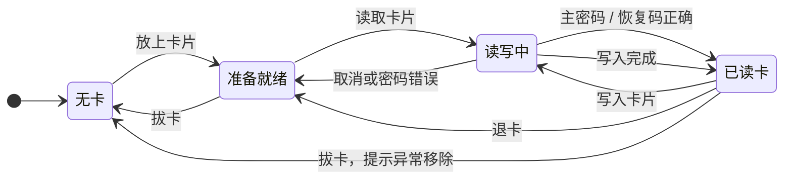
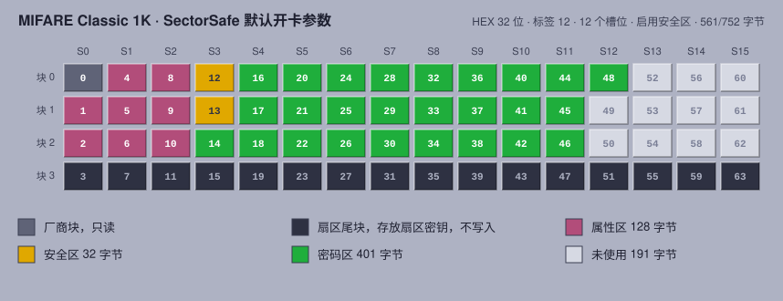
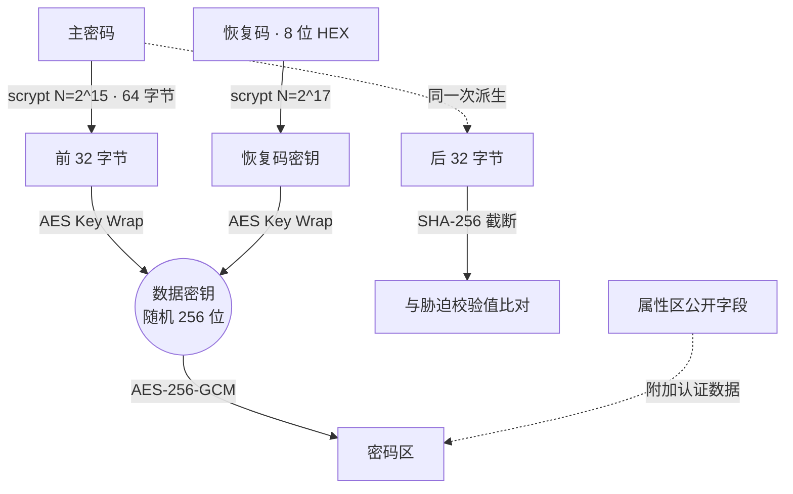
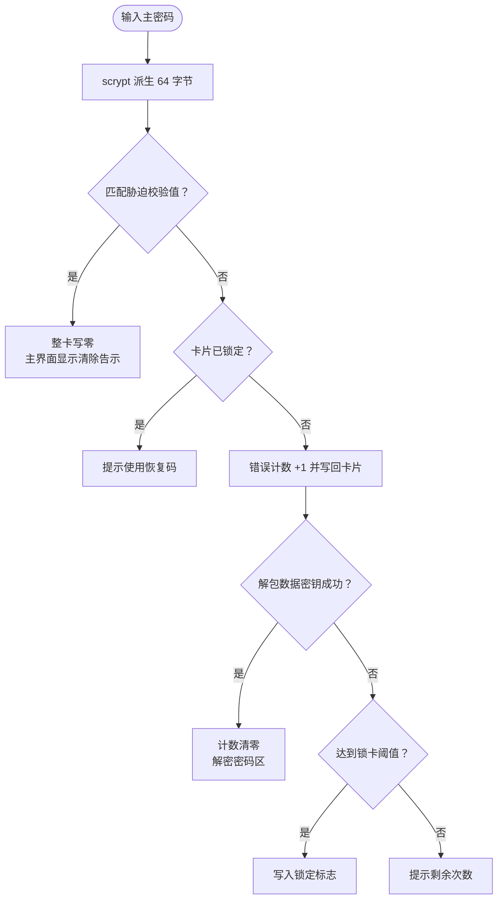

<div align="center">


# SectorSafe

**把密码锁进一张 M1 卡。**

一个跑在桌面上的 MIFARE Classic 密码卡管理器，界面向 CDE / Motif 致敬。


[快速开始](#快速开始) · [卡里存了什么](#卡里存了什么) · [安全模型](#安全模型) · [硬件](#硬件支持) · [路线图](#路线图)

</div>

---

<!-- 截图放到 docs/screenshots/ 后取消下面的注释
<p align="center">
  
  
</p>
-->

## 它能做什么

一张普通的 M1 白卡有 752 字节可用空间。SectorSafe 把它分成属性区、安全区和密码区，在里面存放若干条带标签的密码。卡上只有密文，解锁需要主密码。

- **两种密码模式**：开卡时选择 HEX 或 ASCII。HEX 最长 128 位，ASCII 最长 64 个字符，可以设为定长。
- **容量按最坏情况预留**：每个槽位按标签和密码都写满来分配空间，超出卡片容量的规格在开卡时就会被拒绝。
- **主密码与恢复码**：数据密钥分别由主密码和一组 8 位十六进制恢复码保护，忘记主密码时可以用恢复码解锁，恢复码可以导出为文本文件。
- **胁迫密码**：在解锁框输入胁迫密码，整张卡立即清零。
- **输错锁卡**：主密码连续输错 N 次后锁卡，之后只能用恢复码解锁；恢复码输错 N 次则清卡。N 可调，也可关闭。
- **插拔即感知**：程序持续监测读卡器，卡片被拔走时自动关闭所有窗口并丢弃内存中的密钥。
- **销毁卡片**：一键把全部数据块写零，回到出厂的空白状态。
- **模拟卡**：没有读卡器也能用一个 1 KB 文件当作卡片来跑完整流程。

## 指示灯

主界面左下角有一盏面板指示灯，它决定了你此刻能做什么。

| 灯 | 状态 | 界面 |
|:-:|---|---|
| ⚫ | 无卡 / 未连接读卡器 | 只显示放卡提示 |
| 🟡 | 已检测到卡片，尚未读取 | 显示主界面，按钮为“读取卡片” |
| 🟢 | 已读卡 | 显示条目，按钮变为“退卡” |
| 🔴 | 读写中 | 读卡、解锁、写卡、开卡、销毁时 |



## 卡里存了什么

下图是 1K 卡按默认参数开卡后的样子：HEX 模式，密码最长 32 位，标签最长 12 个字符，12 个槽位，启用安全区。

<p align="center"></p>

0 号块和每个扇区的尾块从不写入，所以 SectorSafe 不会改动扇区密钥，也不会把卡写坏。

<details>
<summary><b>逐字节布局</b></summary>

**属性区**，8 块 128 字节，明文：

| 偏移 | 长度 | 字段 |
|---:|---:|---|
| 0 | 4 | 格式标识 `HXV2` |
| 4 | 1 | 格式版本 |
| 5 | 15 | 卡片名称，ASCII |
| 20 | 1 | 密码模式，0 为 HEX，1 为 ASCII |
| 21 | 1 | 密码最大长度 |
| 22 | 1 | 是否定长 |
| 23 | 1 | 标签最大长度 |
| 24 | 1 | 槽位数 |
| 25 | 4 | 开卡时间，Unix 时间戳 |
| 29 | 1 | 主密码 scrypt 参数 log₂N |
| 30 | 1 | 恢复码 scrypt 参数 log₂N |
| 31 | 1 | 标志位，bit0 表示启用安全区 |
| 32 | 16 | 盐 |
| 48 | 40 | 主密码包装的数据密钥，RFC 3394 |
| 88 | 40 | 恢复码包装的数据密钥，RFC 3394 |

**安全区**，2 块 32 字节，明文，可选：

| 偏移 | 长度 | 字段 |
|---:|---:|---|
| 0 | 16 | 胁迫校验值，未启用时为随机数 |
| 16 | 1 | 锁卡阈值，0 为不启用 |
| 17 | 1 | 主密码连续错误次数 |
| 18 | 1 | 锁定标志 |
| 19 | 1 | 恢复码清卡阈值，0 为不启用 |
| 20 | 1 | 恢复码错误次数 |
| 21 | 11 | 保留 |

**密码区**：`nonce(12) ‖ AES-256-GCM(配置(1) ‖ 槽位 × N) ‖ tag(16)`，属性区前 32 字节作为附加认证数据。

每个槽位：`标志(1) ‖ 标签长度(1) ‖ 标签(L) ‖ 密码长度(1) ‖ 密码`，密码在 HEX 模式下占 ⌈P/2⌉ 字节，ASCII 模式下占 P 字节。

</details>

## 密钥结构



数据密钥在开卡时随机生成，之后不变。修改主密码或更换恢复码只需要重新包装数据密钥，条目不用重新加密。

## 解锁时发生了什么



错误计数在校验之前写回卡片，校验途中拔卡也不能绕过计数。

## 容量速查

开卡向导会实时计算，这里是几组常用规格下能开的最大条目数。

| 模式 | 密码长度 | 标签长度 | 1K | 1K + 安全区 | 4K | 4K + 安全区 |
|---|---:|---:|---:|---:|---:|---:|
| HEX | 16 位 | 8 | 31 | 29 | 172 | 171 |
| HEX | 32 位 | 12 | 19 | 18 | 105 | 104 |
| HEX | 64 位 | 12 | 12 | 11 | 69 | 69 |
| ASCII | 16 字符 | 8 | 22 | 20 | 121 | 120 |
| ASCII | 32 字符 | 12 | 12 | 11 | 69 | 69 |
| ASCII | 64 字符 | 12 | 7 | 7 | 41 | 41 |

## 快速开始

需要 Python 3.9 或更高版本。Windows 上的 Python 已经带了 Tkinter；部分 Linux 发行版需要另装 `python3-tk`。

```bash
git clone https://github.com/VALONSIDE/SectorSafe.git
cd SectorSafe
pip install -r requirements.txt
python sectorsafe.py
```

**没有读卡器？** 用模拟卡：

```bash
python sectorsafe.py --sim test.bin             # 1K 模拟卡，文件不存在时自动创建
python sectorsafe.py --sim big.bin --sim-type 4K
```

模拟模式下点击指示灯可以模拟插卡和拔卡。

<details>
<summary><b>命令行参数</b></summary>

| 参数 | 说明 |
|---|---|
| `--sim FILE` | 使用模拟卡文件 |
| `--sim-type 1K\|4K` | 新建模拟卡的类型 |
| `--reader 关键字` | 按名称选择读卡器，默认优先 PICC 通道 |
| `--key HEX` | 扇区密钥，默认 `FFFFFFFFFFFF` |
| `--key-type A\|B` | 认证用 Key A 或 Key B |
| `--type 1K\|4K` | ATR 无法识别卡型时手动指定 |
| `--version` | 显示版本 |

</details>

<details>
<summary><b>Linux 准备工作</b></summary>

```bash
sudo apt install pcscd libccid python3-tk swig libpcsclite-dev
sudo systemctl enable --now pcscd
```

</details>

## 快捷键

| 按键 | 操作 |
|---|---|
| `Ctrl+O` | 读取卡片 |
| `Ctrl+S` | 写入卡片 |
| `Ctrl+E` | 退卡 |
| `Ctrl+N` | 开卡向导 |
| `Insert` / `Enter` / `Delete` | 新建 / 编辑 / 删除条目 |
| 按住 `空格` | 查看选中条目的密码，松开即隐藏 |
| `Ctrl+C` | 复制密码，30 秒后自动清空剪贴板 |

## 硬件支持

| 读卡器 | 状态 | 备注 |
|---|:-:|---|
| ACS ACR1281U-C1 | ✅ 已验证 | 开发用机，使用 PICC 通道 |
| ACS ACR122U | ⬜ 未实测 | 指令兼容 |
| ACS ACR1252U | ⬜ 未实测 | 指令兼容 |

SectorSafe 通过 PC/SC 伪 APDU（`FF 82` 载入密钥、`FF 86` 认证、`FF B0` / `FF D6` 读写）操作卡片，理论上支持这套指令的 ACS 读卡器都能用。如果你用其他型号跑通了，欢迎提 Issue 告诉我。

卡片支持 MIFARE Classic 1K 与 4K。CPU 卡、MIFARE Plus SL3、DESFire 不支持。

## 安全模型

先说清楚它防什么、不防什么。

| 能防住 | 防不住 |
|---|---|
| 卡片丢失后被人读走内容 | 有人拿到卡后离线穷举弱主密码 |
| 卡片内容被篡改而不被发现 | 有人用其他工具重置卡上的错误计数 |
| 借用你的电脑但不知道主密码的人 | 运行 SectorSafe 的电脑本身已被入侵 |
| 被胁迫时交出胁迫密码 | 对方提前导出了整张卡的数据 |

<details>
<summary><b>为什么这么设计</b></summary>

- **不信任 Crypto1**。MIFARE Classic 自带的扇区加密早已被攻破，SectorSafe 把它当作透明存储，所有保护都来自主机端的 AES-256-GCM。
- **主密码才是真正的防线**。卡上的错误计数是明文，只约束 SectorSafe 本身。对能直接读写卡片的人来说，主密码强度决定了一切。
- **恢复码只有 32 位**。所以它的 scrypt 参数比主密码重 4 倍，单次派生约 128 MB 内存，用来拖慢离线穷举。恢复码请离线保存，不要和卡放在一起。
- **胁迫校验值**用主密码派生结果的后半段计算，未启用时写入随机数，从卡上看不出是否设置了胁迫密码。

</details>

## 项目结构

```
SectorSafe/
├── sectorsafe.py        全部源码，单文件
├── requirements.txt
├── LICENSE
├── README.md
├── tests/
│   └── test_core.py     卡片格式、加密与安全策略测试
└── docs/
    ├── logo.svg
    ├── card-layout.svg
    └── screenshots/
```

`sectorsafe.py` 内部分为四层：卡片访问（PC/SC 与模拟卡）、卡片格式与加密、CDE 风格控件、主窗口与开卡向导。

## 测试

测试全部跑在模拟卡上，不需要读卡器。

```bash
pip install pytest
pytest tests
```

覆盖卡片布局与容量计算、HEX / ASCII 条目读写、属性区篡改检测、输错锁卡与恢复码解锁、胁迫密码清卡、恢复码超限清卡、安全设置变更、整卡销毁，以及 ACR1281U 会话密钥位置和读卡器状态探测。

## 路线图

- [x] MIFARE Classic 1K / 4K
- [x] HEX / ASCII 密码模式
- [x] 胁迫密码、输错锁卡、恢复码保护
- [x] 插拔卡状态感知
- [ ] 补充界面截图
- [ ] Windows 单文件可执行程序
- [ ] 更多读卡器型号实测
- [ ] 加密的条目导入与导出
- [ ] 英文界面

## 第三方组件

| 组件 | 用途 | 许可证 |
|---|---|---|
| [pyscard](https://github.com/LudovicRousseau/pyscard) | PC/SC 读卡器通信 | LGPL-2.1-or-later |
| [cryptography](https://github.com/pyca/cryptography) | AES-GCM、AES Key Wrap | Apache-2.0 / BSD-3-Clause |
| Python / Tkinter | 运行环境与界面 | PSF License |

## 许可证

SectorSafe 以 [Apache License 2.0](LICENSE) 发布。

<div align="center">
<br>
<sub>VALONSIDE · 2026</sub>
</div>
